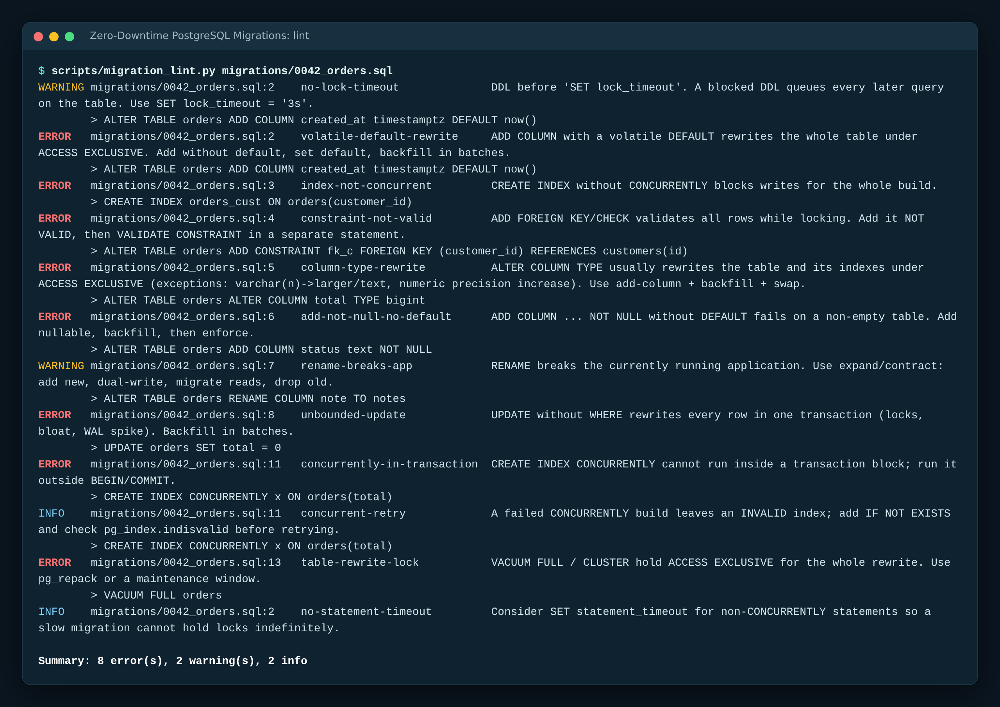

<p align="center"></p>

# Production Ops Guardrails

**Agent skills that make Claude Code, Codex and Cursor safe on real production infrastructure:
PostgreSQL, Docker, Ansible and Prometheus.** Every change is linted, dry-run, confirmed and reversible.

[English](#english) · [Español](#español)

---

## English

Free skills ask the model to "be careful". Ours ship executable gates: a migration that would lock a busy
table fails the linter, an alert that uses a metric your Prometheus does not have fails verification, and
a Compose rollout that turns unhealthy rolls itself back. Every script is tested against real PostgreSQL 16,
Docker 29, ansible-core and Prometheus with node_exporter and postgres_exporter before release.

### Free skill in this repo

**[`postgres-migration-checklist`](skills/postgres-migration-checklist/SKILL.md)**: your agent reviews a
PostgreSQL migration against a lock matrix and tells you what will block reads or writes, with the safe
rewrite. Instructions only, nothing is executed.

```bash
# Claude Code (personal skills)
git clone https://github.com/production-ops-guardrails/skills.git
cp -r skills/skills/postgres-migration-checklist ~/.claude/skills/

# or with skills.sh
npx skills add production-ops-guardrails/skills
```

Then ask your agent: *"Review migrations/0042_orders.sql before we run it in production."*

### The full pack

| Skill | What it does |
| --- | --- |
| Zero-Downtime PostgreSQL Migrations | Lint for 24 lock and data-loss hazards, preflight, rehearse on a schema copy, apply with lock_timeout and retries. |
| PostgreSQL Restore Drill and Backup Audit | Restore into a scratch database, verify exact row counts, get a dated RPO/RTO report. |
| Prometheus Alerting Baseline and SLO Burn Rates | Alerts verified against your own Prometheus, unit-tested and deployed with rollback. |
| Docker Compose Production Audit and Safe Rollout | Find exposed DB ports and docker.sock mounts, roll out with health gates and auto-rollback. |
| Ansible Idempotency Guard | 19 checks, check-mode diff and a second run that must show changed=0. |
| Docker Disk Reclaim and Crash Forensics | Free disk and debug OOM/crash loops without ever deleting a volume. |
| Dockerfile Hardening (add-on) | Non-root, pinned, multi-stage images, smoke-tested before you ship. |

What the paid migration skill does with a risky migration:



**Get it:** [Agensi](https://www.agensi.io/creators/jonnhyx)

### Support

Open an [issue](../../issues/new/choose). Bug reports for paid skills are welcome here too; please do not
paste paid skill files or secrets.

---

## Español

Las skills gratuitas le piden al modelo que "tenga cuidado". Las nuestras incluyen controles ejecutables:
una migración que bloquearía una tabla con tráfico no pasa el linter, una alerta que usa una métrica que tu
Prometheus no tiene no pasa la verificación, y un despliegue de Compose que deja un servicio sin salud se
revierte solo. Cada script se prueba contra PostgreSQL 16, Docker 29, ansible-core y Prometheus reales antes
de publicarse.

### Skill gratuita de este repositorio

**[`postgres-migration-checklist`](skills/postgres-migration-checklist/SKILL.md)**: tu agente revisa una
migración de PostgreSQL con una matriz de bloqueos y te dice qué bloqueará lecturas o escrituras, con la
alternativa segura. Solo instrucciones: no ejecuta nada.

```bash
git clone https://github.com/production-ops-guardrails/skills.git
cp -r skills/skills/postgres-migration-checklist ~/.claude/skills/
```

Después pídele a tu agente: *"Revisa migrations/0042_orders.sql antes de lanzarla en producción."*

### El pack completo

Seis skills (más un add-on) para migraciones PostgreSQL sin caídas, simulacros de restauración con
evidencia, alertas de Prometheus que funcionan de verdad, Docker Compose listo para producción, Ansible
idempotente demostrable y limpieza de disco en Docker sin perder datos.

**Consíguelo en:** [Agensi](https://www.agensi.io/creators/jonnhyx)

### Soporte

Abre un [issue](../../issues/new/choose). No pegues ficheros de las skills de pago ni secretos.

---

The free skill in this repository is MIT-licensed (see [LICENSE](LICENSE)). The paid skills are not
included here and are licensed per purchase.
